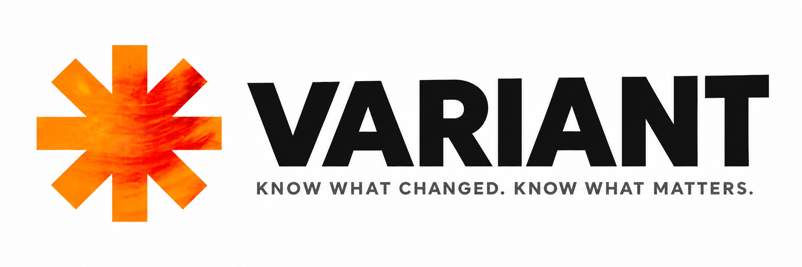

<p align="center">
  <picture>
    <source media="(prefers-color-scheme: dark)" srcset="./public/new-dark-mode.png">
    <source media="(prefers-color-scheme: light)" srcset="./public/new-light-mode.png">
    
  </picture>
</p>

## What is variant?

variant answers one question about the code you just changed:

> **Your tests pass. Would they notice if this code were wrong?**

`variant check` makes small, deliberate mistakes in the lines you changed, one
at a time, runs your tests against each, and lists the mistakes nobody
noticed:

```
Undetected: 1
  src/discount.ts:3:9  in qualifiesForDiscount
    - total >= 100
    + total > 100
    Changing >= to > went undetected. Review the behavior at total = 100.
```

The tests checked 50 and 150 and passed with either operator. Add a test at
100, run it again, and the same mistake is caught. Each finding is a concrete
change to your code, not a score.

It works on the first run, with no history and no config. It looks at what you
have not committed yet, staged or not, and leaves your working tree exactly as
it was.

> **Status**: `0.x`. `variant check` is published as a canary,
> `0.3.0-canary.1`, under the `canary` tag: install `@blzsky/variant@canary`.
> Without the tag npm serves 0.2.1, which has no `check`. Any minor release
> can break, and every break is in the [CHANGELOG](./CHANGELOG.md).

## Install

variant needs Node 22 or newer, a git repository, and Vitest (4.1 is tested; 5.0 has been tried) or Jest (30 is tested; 29.3 or newer).

```bash
npm install -D @blzsky/variant@canary
```

Install it in the package whose code you change, beside its test runner; the
Vitest or Jest it runs your tests with is yours.

The package is `@blzsky/variant`; the binary it installs is `variant`.
`npx variant` fetches an unrelated package, so always use the scope with `npx`.

### Upgrade

```bash
npm install -D @blzsky/variant@latest
```

Because variant is `0.x`, read the CHANGELOG before moving to a new minor
version.

## Usage

```bash
npx @blzsky/variant check                    # before you commit
npx @blzsky/variant check --base main        # everything this branch changes
npx @blzsky/variant check --fail-on-survivors --json   # in CI
```

Run it from the package whose code changed, where its Vitest or Jest config is.

- **What it compares against.** With uncommitted changes, HEAD: your staged
  and unstaged edits. On a clean branch, the commit it left the default branch
  at. On GitHub Actions, the pull request's merge base, or the commit a push
  replaced. When none of these applies it stops and asks for `--base` instead
  of guessing.
- **What it mutates.** Comparisons (`>=` to `>`, `===` to `!==`), boolean
  conditions (`&&` to `||`, a condition forced to `true` or `false`) and
  arithmetic (`+` to `-`), in the changed lines of TypeScript source files,
  and all of a new file you have not `git add`ed yet. Test files, declaration
  files and files whose change is only formatting or comments are not
  mutated; the report lists them and why.
- **First, the tests must pass as they are.** If one fails, variant stops: a
  failure could not then be told apart from one a mutation caused.
- **What it reports.** Each mutation the tests did not notice, with the exact
  change and what to review; code no test executed, listed apart; timeouts and
  errors as inconclusive; what was not run and why; how many tests ran; and how
  long it took. When every mutation is detected it says so, and says that this
  is evidence the tests check those lines, not proof the change is correct.
- **Bounded.** At most `--max-mutants` mutations (default 50, the same ones
  every run) within `--budget` (default 5 minutes, the first test run
  included). A run that stops early says `Incomplete` and lists what it did
  not run. It never reads as clean.
- **Advisory.** It exits 0 whatever it finds. `--fail-on-survivors` exits 1
  when a mutation went undetected or unreached, or the run is incomplete.

The [`check` guide](./docs/check.md) has every flag, the CI setup, and how to
read a result. [`examples/check-demo`](./examples/check-demo) is the example
above, ready to run, and [`examples/check-demo-jest`](./examples/check-demo-jest)
is the same with Jest.

## How it compares

**Mutation testing is not new.** [StrykerJS](https://stryker-mutator.io/)
mutates JavaScript and TypeScript and runs your tests against each mutant, has
an incremental mode that reuses earlier results, and can be pointed at a set of
files or lines. variant runs on Stryker; it does not replace it. What variant
adds is the workflow around it: it works out which lines changed, mutates only
those, keeps the run bounded, explains each surviving mutation in terms of the
line you wrote, and leaves your working tree alone. If you already run Stryker
over a whole project, you have the data `check` gives you, and more.

**Coverage is weaker evidence.** A line counts as covered when a test runs it,
whether or not anything checks the result. The example above is 100% covered.

## Limitations

- **A surviving mutation is a finding to review, not a bug.** Some mutations
  change nothing a valid input can observe: `>=` and `>` agree everywhere a
  value can never equal the boundary. variant does not detect those, and does
  not promise to.
- **Detected is not verified.** All mutations detected means the tests that ran
  noticed these particular mistakes. It says nothing about mistakes of other
  kinds, or about lines that were not mutated.
- **Only three kinds of mistake.** Comparisons, conditions and arithmetic.
  Strings, literals, removed calls and removed statements are not mutated.
- **Deleted lines cannot be mutated.** A change that only removes code gets no
  mutation; the report says how many lines that was.
- **Mutations are not type-checked.** One that TypeScript would reject still
  runs.
- **Code run in another process reads as unreached.** Coverage is measured in
  the test process, so a test that drives a CLI or a server it starts does not
  count as executing that code.
- **Flaky tests can count as detection.** A test that fails at random while a
  mutation is in place is read as noticing it.
- **One test project, run from its package.** Workspace roots, Vitest browser
  mode and a Jest config with `projects` are not supported yet.

## Pull request reports

variant also explains pull requests: one comment on each that says what the
change affects, which tests reach it and why, and what no test reaches. This is
what `variant init` sets up. It predates `check`, and works as it did.

### Setting up

```bash
npx @blzsky/variant init            # shows the changes, asks, then applies
npx @blzsky/variant init --dry-run  # only look
```

```bash
npx @blzsky/variant init            # shows the changes, asks, then applies
npx @blzsky/variant init --dry-run  # only look
```

`init` installs `@blzsky/variant` as a dev dependency with your package
manager (npm, pnpm, Yarn or Bun), adds the
[Vitest adapter](./docs/vitest-adapter.md) to your test config, ignores
`.variant/`, gives your test workflow's checkout the history a prediction
needs, and writes `.github/workflows/variant.yml`. Anything it cannot edit
with confidence it leaves alone and tells you the lines to add.

The package is `@blzsky/variant`; the binary it installs is `variant`.
`npx variant` fetches an unrelated package, so always use the scope with `npx`.

### What you see

After `init` there is nothing to run. What you see:

- **On every pull request**, one comment, kept up to date: the risk of each
  changed file, the tests to run and why, the checks, and what is not
  verified. [An example](./docs/api.md#pr-report).
- **In every CI test run**, one line saying what was predicted and whether a
  failure fell outside it.

The first runs after setup select every test, because the setup itself changes
the lockfile and the test config. Narrowed predictions start with the next
pull request.

The commands underneath are still there when you want them:

```bash
variant pr report --markdown               # the pull request comment, locally
variant impact                             # which tests does this change need?
variant workspace check                    # undeclared dependencies (exits 1)
```

<p align="center">
  
</p>

| Command | What it does |
|---|---|
| `impact` | Predict which test files a change requires, and how much of the import graph resolved. Report-only. |
| `impact verify <report...>` | Reconcile the last prediction against one or more Vitest or Jest JSON reports and report false skips |
| `diff <file>` | Classify one file's change and list the exported symbols that changed |
| `init` | Set a repository up: the dependency, the adapter, the workflow. Once. |
| `pr check` | Classify every TypeScript change on the branch and roll them into one build verdict |
| `pr report` | What the branch changes and what has to be verified, as JSON or as markdown for a PR comment |
| `workspace check` | Fail when a package imports a dependency it does not declare |

Run `variant <command> --help` for its flags, or see the
[CLI reference](./docs/cli-reference.md). The [tutorial](./docs/tutorial.md)
walks through every command on a sample monorepo in about fifteen minutes.

Every changed file gets one of three classifications. `non-impacting` means
only comments or formatting changed, and selects no tests. `internal` means the
body changed but the exported surface did not, and selects every test that
imports the file. `breaking` means an exported signature changed, and also
follows the importers of the changed names for `pr check`'s verdict. A change
to `package.json`, a lockfile, `tsconfig*.json`, a test runner config or a test
setup file selects every test.

### In CI, by hand

`init` writes what CI needs. To wire the commands in by hand: check out
with `fetch-depth: 0`; the base is detected on GitHub Actions, and elsewhere
pass `--base origin/<branch>`. A shallow
clone has no base commit to compare against, and `actions/checkout` creates no
local branch for the target; variant stops with `GIT_REF_ERROR` rather than
guess.

Ready-to-copy GitHub Actions workflows are in
[`examples/github-actions`](./examples/github-actions):

- [`pr-report.yml`](./examples/github-actions/pr-report.yml) keeps one sticky
  comment with the verdict on every pull request.
- [`workspace-check.yml`](./examples/github-actions/workspace-check.yml) fails
  the build on an undeclared dependency.
- [`impact-shadow.yml`](./examples/github-actions/impact-shadow.yml) logs a
  prediction, runs the full suite anyway, and reconciles the two.
- [`impact-shadow-workspace.yml`](./examples/github-actions/impact-shadow-workspace.yml)
  does the same for a pnpm workspace that tests each package on its own. It
  needs a release newer than 0.2.1.

### Help measure it

A false skip is a test that failed and that the prediction did not select. The
false-skip rate is false skips divided by failed test files, with flaky
failures counted against variant. One repository is not enough to trust it.

If you add `impact-shadow.yml` to your CI, it changes nothing about your build.
It uploads the counts as a `variant-reconciliation` artifact: commit SHAs,
branch names and numbers, no file paths and no source.
[Share them in an issue](https://github.com/saintparish4/variant/issues/new?template=3.shadow_results.yml),
and they go into the measurement that decides whether skipping ever ships. The
[measurement log](./docs/measurement.md) has every number collected so far.

### How the reports compare

**Nx `affected`, Turborepo `--filter`.** These work at the level of projects
and tasks: a change inside `utils` reruns the test target of `utils` and of
every project that depends on it. In the example above, that is all four test
files. variant works at the level of test files and follows each one's imports
across packages, so it runs two. Nx and Turborepo also cache and orchestrate
tasks; variant's `impact` does neither, and the two can be used together.

**`vitest related`, `jest --findRelatedTests`.** These follow imports at the
file level too, within one project. variant adds two things: import chains that
cross workspace packages, and classification, so a change to comments or
formatting selects no tests at all.

**Not function-level.** Test selection is by file: a test that imports a changed
file runs, whichever functions it calls. The exported-surface classification
decides `pr check`'s build verdict and whether a change selects anything, not
which functions a test touches.

### What the reports cannot see

Worth knowing before you trust a prediction. variant reads source statically,
so it sees imports and nothing else. It widens the selection or lowers its
confidence wherever it can tell it is missing something, but some edges it
cannot see at all:

- **Runtime-only wiring is invisible.** Dependency injection by token,
  string-keyed registries and `eval` never appear as imports. A test that
  reaches code only this way is not selected, and nothing in the output says
  so. This is the largest blind spot.
- **Service boundaries end the graph.** An end-to-end test that calls a running
  server imports none of the code it exercises.
- **Setup files are recognized by name.** `vitest.setup.ts`, `setupTests.ts`,
  `global-setup.ts` and the like select every test; a setup file named
  anything else selects none. variant does not read the runner config.
- **Files read at runtime are outside the closure.** A changed stylesheet or
  JSON file that a TypeScript file imports selects that file's tests, but a
  fixture, snapshot or asset a test reads with `fs` is invisible. A changed
  file that reaches no test is listed as `Unreached`.
- **Only the directory it runs in is indexed.** A file changed elsewhere in
  the repository selects the tests of the files that import it by relative
  path, and is listed as `Unreached` otherwise.
- **Unreached is not the same as untested.** A changed file no test reaches
  is listed as `Unreached` and the prediction reads `low`. variant cannot tell
  an untested file from one a runtime lookup uses.
- **JavaScript is indexed when git says it is yours.** Tracked or new
  `.js`, `.jsx`, `.mjs` and `.cjs` files are read like TypeScript; build
  output and bundles are not. A changed CommonJS module reaches everything
  that requires it.
- **Computed imports are followed only as far as their literal start.**
  `` import(`./locales/${lang}.js`) `` reaches everything under `./locales/`;
  `import(name)` could load anything, and is a standing note on every run.
- **Dynamic `import()` is assumed to use everything.** The change propagates
  and a note is printed; the run gets wider, not narrower.
- **Workspace discovery can miss a package**, and a bare import of a package it
  missed counts as external. `impact` prints how many packages it found and
  notes imports no discovered package or manifest accounts for.
- **Type-only changes are not narrowed.** Changing an interface selects every
  test that imports the file, though no runtime behavior changed.
- **The confidence score is not a safety number.** It says how much of the
  import graph resolved, as `high`, `medium` or `low` and a percentage. Only
  the false-skip rate says how safe a skip would have been.

The full list, with how each case is handled, is in
[Impact & workspace](./docs/impact-and-workspace.md#limitations).

## Benchmarks

Measured by CI on 2026-09-28 with [`benchmarks/bench.mjs`](./benchmarks/bench.mjs),
on a generated git repository of 300 TypeScript files with 25 changed. Each
number is the median of the runs shown. Machine: AMD EPYC 9V74 (4 cores),
16 GB RAM, Linux, Node 22.23.2, hyperfine 1.18.0.

| | Median | Runs |
|---|---:|---:|
| `variant --help` (startup) | 36.7 ms | 20 |
| `variant impact`, 25 changed files of 300 | 988 ms | 10 |

- **Startup is a CI gate.** The benchmark workflow fails when the `--help`
  median passes 200 ms, because every command is loaded only when it runs.
- **The symbol index is cached.** `.variant/graph/symbols.json` keeps each
  file's exports and imports keyed by content hash, so a later run re-parses
  only the files whose content changed.
- **Large real repositories are not measured yet.** 300 generated files say
  how the pipeline behaves, not what it costs on your monorepo. Whether the
  analysis pays for itself depends on how long your suite takes, and that
  number has to come from real runs.

Reproduce with `pnpm build && pnpm bench`; the methodology is in
[`benchmarks/README.md`](./benchmarks/README.md).

## Documentation

| | |
|---|---|
| [`check`](./docs/check.md) | Would your tests notice? Flags, CI, reading a result, limits |
| [Tutorial](./docs/tutorial.md) | Every command, step by step, on a sample monorepo |
| [Getting started](./docs/getting-started.md) | Run it on your own repository, then set up the task runner |
| [Impact & workspace](./docs/impact-and-workspace.md) | How `impact` and `workspace check` work, and what static analysis cannot see |
| [PR commands](./docs/pr-commands.md) | `pr check` and `pr report` |
| [Vitest adapter](./docs/vitest-adapter.md) | One config line in place of the commands: predict and check on every test run |
| [CLI reference](./docs/cli-reference.md) | Every command, flag, exit code and file |
| [API reference](./docs/api.md) | `defineConfig`, the config types, and every JSON output |
| [Monorepo setup](./docs/monorepo.md) | Workspace tasks and `--affected` |
| [Config reference](./docs/config-reference.md) | Every `variant.config.ts` key |
| [Troubleshooting](./docs/troubleshooting.md) | Common problems and what they mean |
| [Measurement log](./docs/measurement.md) | Every prediction checked against a full run so far, and the gate skipping has to pass |

## Contributing

See [CONTRIBUTORS.md](./CONTRIBUTORS.md) to set up the repository, run the
tests, and check a change before opening a pull request.

## License

MIT — see [LICENSE](./LICENSE).
